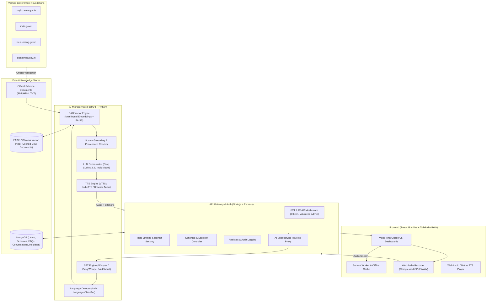

# BOLO System Architecture

## 1. Overview
**BOLO** ("बोलो" / "Speak") is a voice-first, multilingual digital public-service assistance platform tailored for rural, semi-urban, elderly, and low-literacy Indian citizens. It bridges the digital divide by replacing complex web portals and long paperwork with conversational voice assistance in regional Indian languages.

---

## 2. Architecture Diagram

---

## 3. Core Modules & Interaction Flow

### A. Voice-First Interaction Cycle
1. **User Query**: Citizen speaks: *"मला प्रधानमंत्री किसान योजनेचा लाभ कसा मिळेल?"* (How do I get PM-KISAN benefits?)
2. **Audio Capture**: Browser records audio with client-side noise suppression and compression.
3. **STT & Language Identification**: The audio is processed by the AI microservice using Whisper/Groq Whisper; language is recognized as Marathi (`mr`).
4. **Knowledge Retrieval (RAG)**: The normalized transcript is queried against the indexed vector embeddings of official government scheme circulars (PM-KISAN operational guidelines).
5. **Contextual Grounding**: Retrieved chunks have verified source provenance (Department of Agriculture & Farmers Welfare, source URL: `myscheme.gov.in`).
6. **Simplified Synthesis**: The LLM synthesizes an explanation in clear, simple Marathi:
   - What the scheme is (₹6,000 per year in 3 installments).
   - Basic eligibility criteria (land-holding farmer families).
   - Mandatory documents (Aadhaar, Land records/7/12 extract, Bank account linked to Aadhaar).
   - Application step (visit local CSC/Gram Panchayat or apply online at pmkisan.gov.in).
   - Official Helpline (155261 / 011-24300606).
7. **Speech Synthesis (TTS)**: Response is converted to natural audio and streamed back.
8. **UI Rendering**: Citizen hears the voice answer immediately, while UI renders verified badges, checklist, and one-tap helpline dialer.

---

## 4. Key Design Principles

1. **Zero Hallucination / Source Provenance**:
   - Every answer is strictly grounded in verified government documents.
   - If confidence is below threshold ($0.65$), the system refuses to guess and directs citizen to the nearest Common Service Centre (CSC) or official helpline.
2. **Low-Connectivity Resilience**:
   - Progressive Web App with service worker offline caching.
   - Core scheme directory, emergency helplines, and offline FAQ fallbacks are cached locally.
   - Visual status badges inform the user when viewing cached data.
3. **Role-Based Access Control**:
   - **Citizen**: Voice inquiry, eligibility check, document checklist, conversation history.
   - **Volunteer**: Field assistance mode, quick search, assisted query tracking.
   - **Administrator**: RAG document ingestion, scheme CRUD, helpline management, analytics.
